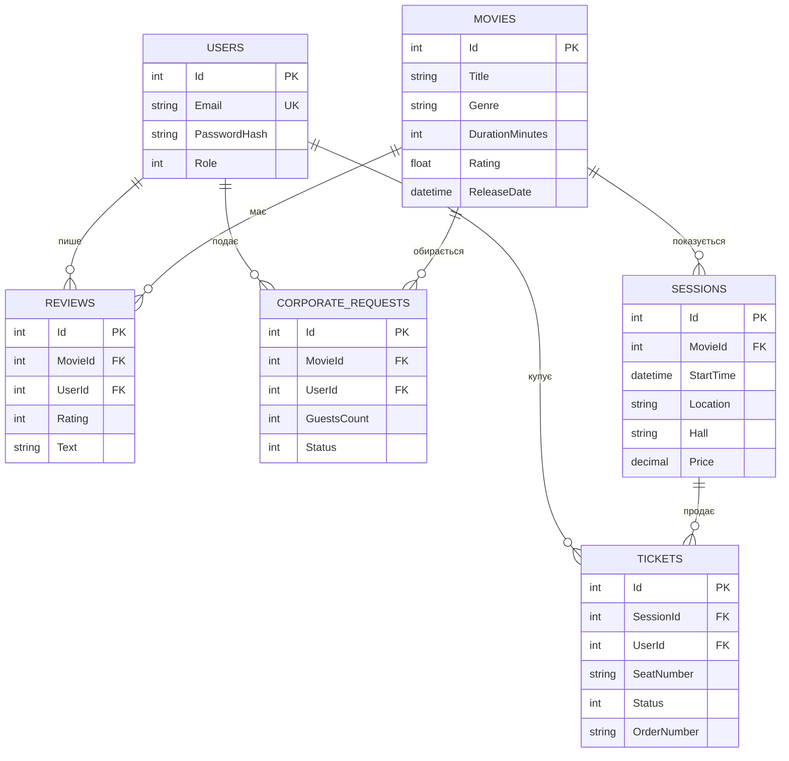

# Показ Тіней: база даних

Microsoft SQL Server. Тут усе, що потрібно, щоб розгорнути базу `PokazTiney` з тестовими даними на новому комп'ютері.

## Предметна область

«Показ Тіней» це платформа для організації та відвідування кінопоказів у кінотеатрі, на відкритих майданчиках міста (парк, набережна, дах) і в закритому форматі (приватні заявки).

- **Глядач / гість** переглядає каталог і розклад, бронює місця на схемі залу, оплачує квитки, залишає відгуки, керує профілем.
- **Організатор / адміністратор** наповнює каталог фільмів і сеансів, опрацьовує заявки на приватні покази.

Бізнес-правила:
- одне місце на сеанс продається один раз (скасований квиток місце звільняє);
- місця утримуються 10 хвилин після переходу до оплати;
- зал: 5 рядів по 8 місць, ряд 5 це VIP (надбавка 50 грн), сервісний збір 5%;
- фільми з майбутньою датою виходу показуються лише в «Скоро у прокаті» й не бронюються;
- відгуки можуть залишати лише зареєстровані користувачі.

## Схема даних



Кодування полів-переліків:
- `Users.Role`: 0 Viewer, 1 Manager, 2 Admin;
- `Tickets.Status`: 0 Pending, 1 Paid, 2 Cancelled;
- `CorporateRequests.Status`: 0 New, 1 UnderReview, 2 Confirmed, 3 Rejected.

## Файли

| Файл | Призначення |
|---|---|
| `01_schema.sql` | створює базу `PokazTiney` і всі таблиці, ключі та індекси (можна запускати повторно) |
| `02_seed.sql` | демо-глядачі, 21 фільм, відгуки (якщо дані вже є, нічого не робить) |
| `03_generate_sessions.sql` | розклад на 7 днів уперед; **запускайте повторно, коли розклад застаріє** |

Скрипти мають бути збережені в UTF-8 **з BOM**, інакше українські літери зламаються. Зазвичай після клонування репозиторію нічого міняти не треба.

## Вимоги

- Microsoft SQL Server 2019 або новіший: підходить безкоштовний **SQL Server Express** (або Docker-образ, див. нижче);
- SSMS або Azure Data Studio, або консольна утиліта `sqlcmd`;
- для запуску API: .NET 10 SDK.

> Про LocalDB. Якщо `(localdb)\MSSQLLocalDB` видає помилку 52, LocalDB не встановлено. Поставте її через Visual Studio Installer або використайте SQL Server Express.

## Варіант A: SQL-скрипти (SSMS або sqlcmd)

**SSMS / Azure Data Studio:** підключіться до свого сервера, відкрийте й виконайте по черзі `01_schema.sql`, `02_seed.sql`, `03_generate_sessions.sql` (кнопка Execute, F5).

**sqlcmd (PowerShell, з кореня репозиторію):**

```powershell
$srv = ".\SQLEXPRESS"      # або "localhost", "(localdb)\MSSQLLocalDB"
sqlcmd -S $srv -E -C -b -f 65001 -i database\01_schema.sql
sqlcmd -S $srv -E -C -b -f 65001 -i database\02_seed.sql
sqlcmd -S $srv -E -C -b -f 65001 -i database\03_generate_sessions.sql
```

`-E` це вхід за обліковим записом Windows, `-C` довіряти сертифікату сервера, `-f 65001` читати файл як UTF-8.

## Варіант Б: через EF Core міграції

Підходить, якщо на комп'ютері є .NET SDK. Схему створюють міграції проєкту, дані та розклад додають скрипти.

```powershell
dotnet tool install --global dotnet-ef        # один раз
cd PokazTiney.Api
dotnet ef database update
cd ..
sqlcmd -S .\SQLEXPRESS -E -C -b -f 65001 -i database\02_seed.sql
sqlcmd -S .\SQLEXPRESS -E -C -b -f 65001 -i database\03_generate_sessions.sql
```

**Не змішуйте варіанти A і Б на одній базі.** База, створена скриптом `01_schema.sql`, не має історії міграцій, тож `dotnet ef database update` на ній видасть помилку «already exists». Для нової бази оберіть один шлях, а для переходу між ними спершу скиньте базу (див. нижче).

## Docker (якщо SQL Server не встановлено)

```powershell
docker run -e "ACCEPT_EULA=Y" -e "MSSQL_SA_PASSWORD=Your_strong_Passw0rd" `
  -p 1433:1433 --name pokaz-sql -d mcr.microsoft.com/mssql/server:2022-latest

docker cp database pokaz-sql:/tmp/database
foreach ($f in "01_schema","02_seed","03_generate_sessions") {
  docker exec pokaz-sql /opt/mssql-tools18/bin/sqlcmd -S localhost -U sa -P "Your_strong_Passw0rd" -C -b -f 65001 -i "/tmp/database/$f.sql"
}
```

## Підключення API до бази

Рядок підключення читається з параметра `ConnectionStrings:Default`. **Не зберігайте пароль у репозиторії.** Найпростіше задати рядок через user-secrets:

```powershell
cd PokazTiney.Api
dotnet user-secrets init
dotnet user-secrets set "ConnectionStrings:Default" "Server=.\SQLEXPRESS;Database=PokazTiney;Trusted_Connection=True;TrustServerCertificate=True"
```

Приклади рядків:

| Сервер | Рядок |
|---|---|
| SQL Server Express | `Server=.\SQLEXPRESS;Database=PokazTiney;Trusted_Connection=True;TrustServerCertificate=True` |
| LocalDB | `Server=(localdb)\MSSQLLocalDB;Database=PokazTiney;Trusted_Connection=True;TrustServerCertificate=True` |
| Docker | `Server=localhost,1433;Database=PokazTiney;User Id=sa;Password=Your_strong_Passw0rd;TrustServerCertificate=True` |

Запуск:

```powershell
cd PokazTiney.Api
dotnet run --launch-profile http
```

## Перевірка

```sql
USE PokazTiney;
SELECT COUNT(*) AS Movies   FROM dbo.Movies;     -- 21
SELECT COUNT(*) AS Sessions FROM dbo.Sessions;   -- кілька сотень
SELECT COUNT(*) AS Reviews  FROM dbo.Reviews;    -- 7
```

У браузері: `http://localhost:5289/api/movies` має повернути список фільмів, а `http://localhost:5289/swagger` документацію API.

## Фронтенд

Постери кладуться в `frontend/images/` (імена файлів збігаються з `Movies.PosterUrl`, наприклад `images/oppenheimer.jpg`). Сайт відкривайте через Live Server з папки `frontend`. Адреса API задається константою `API` на початку `frontend/app.js`.

## Облікові записи

- Демо-глядачі з `02_seed.sql` (`oleksiy.k@example.com` тощо) лише автори тестових відгуків, пароля в них немає, увійти під ними не можна.
- Для роботи зареєструйтесь на сайті (`login.html`).
- Зробити користувача адміністратором:
  ```sql
  UPDATE dbo.Users SET [Role] = 2 WHERE Email = N'your@email.com';
  ```

## Оновити розклад

Сеанси генеруються від дати запуску. Коли розклад застаріє, виконайте ще раз `03_generate_sessions.sql`: сеанси з проданими квитками залишаться, решта майбутніх перестворяться.

## Скинути базу

```sql
USE master;
ALTER DATABASE PokazTiney SET SINGLE_USER WITH ROLLBACK IMMEDIATE;
DROP DATABASE PokazTiney;
```
Потім повторіть розгортання з початку.

## Типові проблеми

| Проблема | Що робити |
|---|---|
| Error 52 / «Unable to locate a Local Database Runtime installation» | LocalDB не встановлено: поставте її або використайте SQL Server Express |
| «Cannot open database requested by the login» | база ще не створена: виконайте `01_schema.sql` або `dotnet ef database update` |
| Замість української кракозябри | збережіть `.sql` у UTF-8 з BOM, для `sqlcmd` додайте `-f 65001` |
| «The ConnectionString property has not been initialized» | не задано `ConnectionStrings:Default` (див. user-secrets вище) |
| Сайт показує «Не вдалося завантажити дані» | API не запущено, або порт у `frontend/app.js` не збігається з `launchSettings.json` |
| На сайті порожній розклад | розклад застарів: виконайте `03_generate_sessions.sql` |
| Сертифікат SQL Server не довіряється | додайте `TrustServerCertificate=True` у рядок підключення, а в `sqlcmd` ключ `-C` |